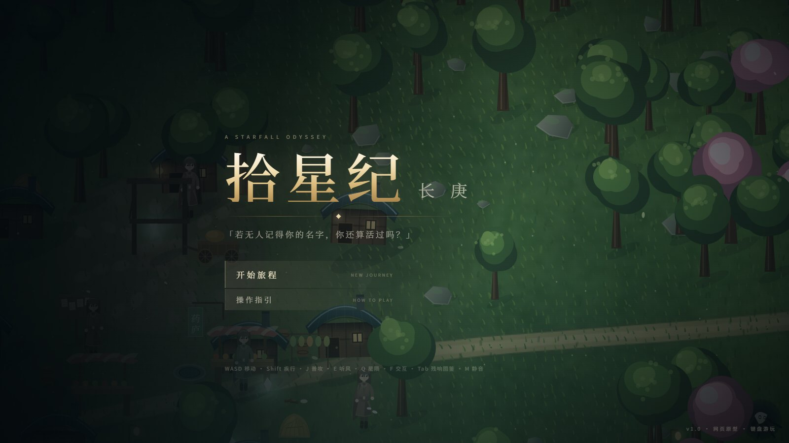
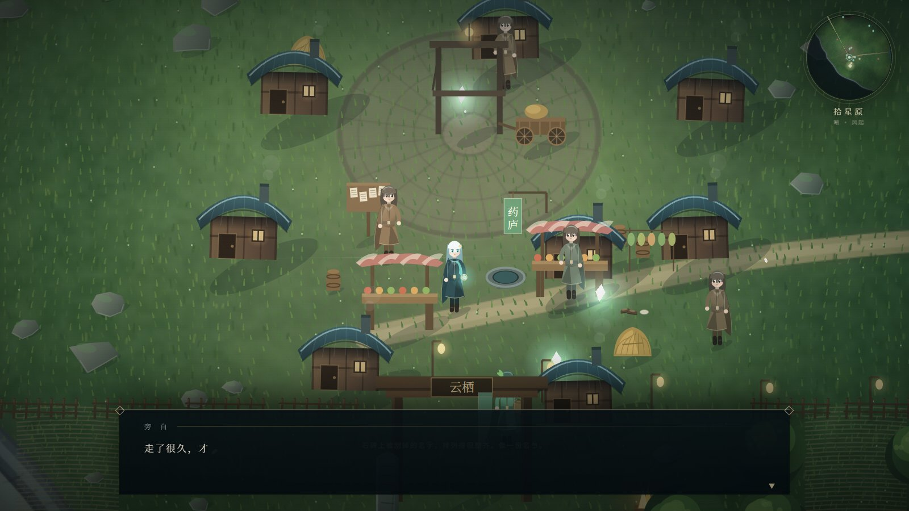
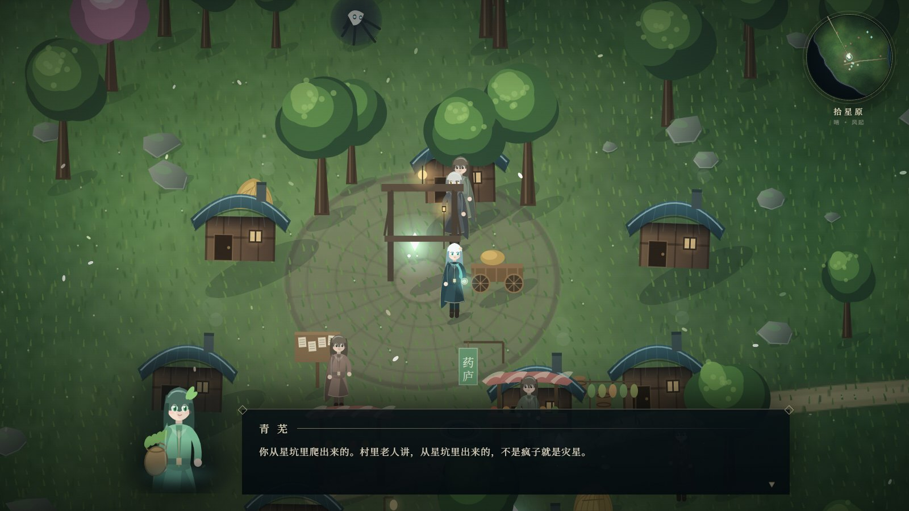
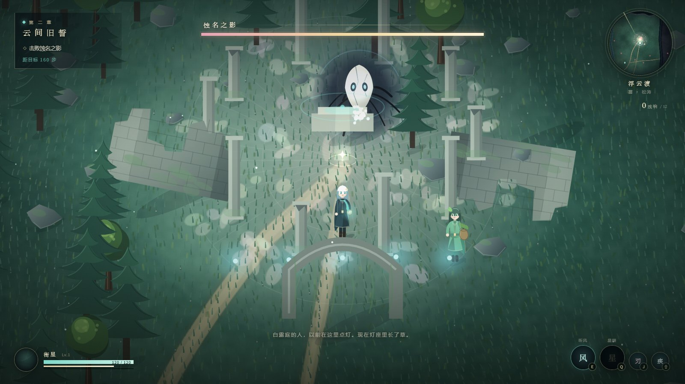
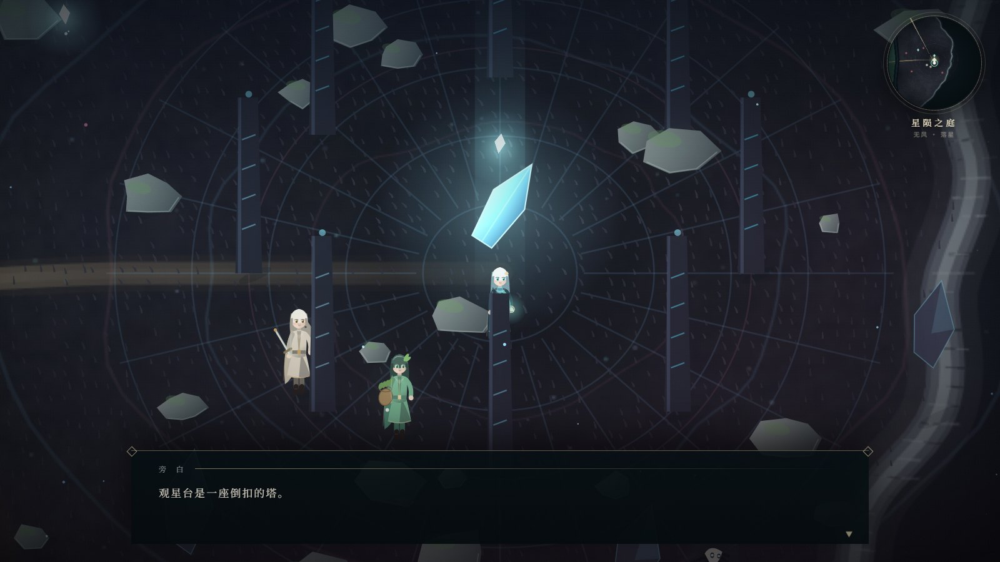
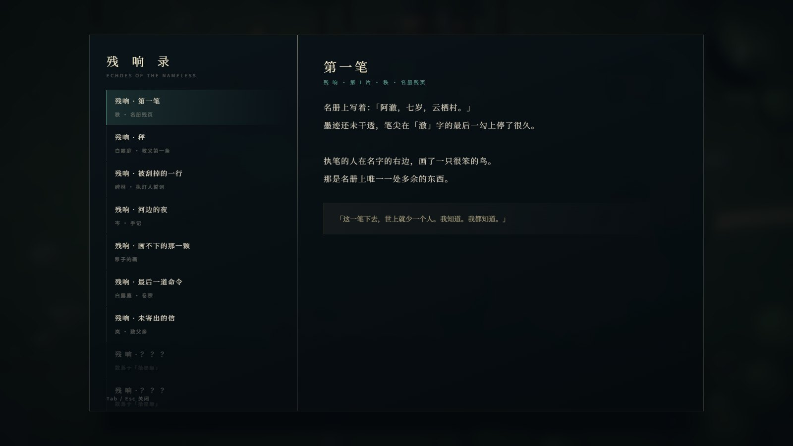
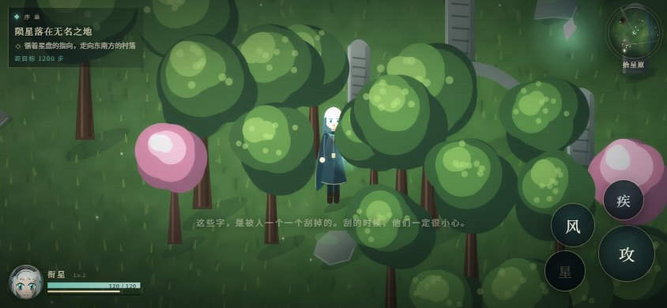
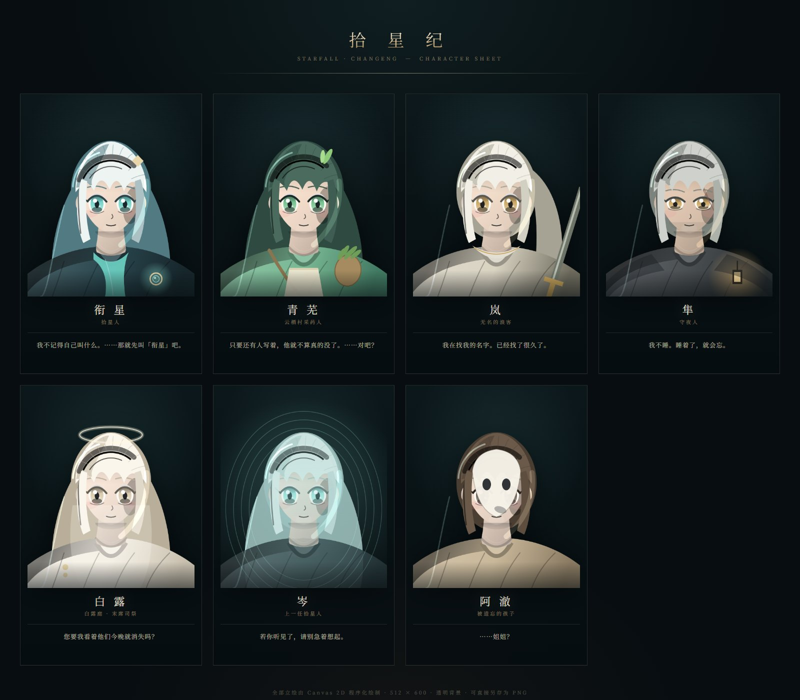

# 拾星纪 · 长庚

> 一座悬于云海之上的大陆，一道断裂的星环，一场没有声音的退潮。
>
> 每当星落，人间就有人被遗忘——不是死亡，是名字被「取走」。

一个可以在浏览器里直接打开游玩的、类米哈游风格的开放世界动作叙事原型。
全部美术、音乐、剧情均由代码现场生成，无任何外部素材依赖（字体除外，缺失时自动回落系统衬线体）。









---

## 一、如何运行

**双击 `index.html` 即可。** 不需要服务器、不需要构建、不需要联网。

- 推荐 Chrome / Edge 最新版，窗口 1600×900 以上。
- 首次进入会花 1～3 秒「编织星图」（程序化烘焙 7200×4800 的大陆底图）。
- 开场是「黑幕 + 两句旁白」的冷开场：**点击画面任意处 / 空格** 继续，第三句起世界淡入。
- 点击「开始旅程」后建议戴上耳机——配乐与音效是实时合成的。
- 进度自动保存在 localStorage，标题页可「继续前行」。

## 二、操作

| 按键 | 动作 |
| --- | --- |
| `W A S D` | 移动 |
| `Shift` | 疾行（消耗体力，可行走中残影） |
| `J` / 鼠标左键 | 三段普攻（第三段带击退与顿帧） |
| `E` | **听风** · 风元素范围冲击 + 冲击波 |
| `Q` | **星陨** · 元素爆发（能量满 100 时，天降六星） |
| `F` / `空格` | 交互：对话、拾取星骸、触碰残响 |
| `Tab` | **残响录**（碎片化叙事的收集与回看） |
| `M` | 静音 |
| `Esc` | 关闭面板 |

> 迷路时抬头看：任务目标处会落下一道星芒，右上角小地图也会标出金色菱形。

---

## 三、世界观与主线

**长庚**，悬于云海之上。天顶有一道断裂的光弧，名为「星环」。
传说星环需以「名」为薪，每百年一祭，可挡云海之下的「蚀」。
祭名的人叫**拾星人**；执行仪式的教团叫**白露庭**。

主角在陨星坑中醒来，记忆全无，手里只有一枚裂成三瓣的星盘——
它能听见被遗忘者留下的最后一点动静，称为**残响**。

### 五幕结构

| 幕 | 章节 | 地点 | 剧情节点 |
| --- | --- | --- | --- |
| 序 | 陨星落在无名之地 | 拾星原 · 陨星坑 → 云栖村 | 醒来、拾星盘、结识青芜、初见守夜人隼 |
| 一 | 风 的 碑 文 | 风蚀碑林 | 第一枚回声；归村；失名兽袭村；阿澈失踪之谜浮出 |
| 二 | 云 间 旧 誓 | 浮云渡 · 白露庭遗迹 | 与岚试剑；遗迹壁画；**蚀名之影**（Boss）；白露现身 |
| 三 | 无 声 之 潮 | 星陨之庭 · 观星台 | 真相：献名的代价；**白露**（Boss）；三重抉择 |
| 终 | 记 名 | —— | 三种结局 |

### 三条结局

- **续约** —— 取走云栖村的名字，再换长庚百年。你记得所有人，而没有人记得你。
- **断环** —— 击碎星环，名字归还人间，蚀漫上来。
- **记名**（真结局，需收集 **8 片残响**）—— 把自己写成星环，从此每一阵风里都有一个名字。

---

## 四、草蛇灰线：伏笔与回收表

这是本项目在叙事上最用心的地方——**所有关键台词都在前面出现过两次以上**。

| # | 伏笔（前文原句） | 回收（后文真相） |
| --- | --- | --- |
| 1 | 青芜：「名字是别人给你的，不是自己取的。」 | 真结局主角为所有人「给」名字，并把自己写进风里 |
| 2 | 村口石碑上被刮花的名字 | 第一章碑林揭示：那是「献名」制度的产物 |
| 3 | 药方背面三百张「阿澈」 | 第三章：阿澈是本轮第一个被取走的名字（第一笔税） |
| 4 | 隼：「我不睡，因为遗忘只在睡着的时候发生。」 | 残响 VII：他守了一辈子夜，最后忘了自己叫谁 |
| 5 | 岚：「我不记得自己为什么带着剑。」剑鞘上被磨掉的字 | 白露点名册：岚是自己把名字押在桥上的 |
| 6 | 星盘指针「非北，乃未竟之名」 | 它第一次醒来时转得那么急，是在找阿澈 |
| 7 | 每片星骸都带编号（第一笔、第二笔……） | 献名是一份有名册的账 |
| 8 | 孩童：「天上少了一颗星，是被人藏起来了吗？」 | 星 = 名字；星环 = 账本 |
| 9 | 白露：「您是刀，刀不该记得自己切过什么。」 | 主角每次献名后自我抹除记忆，已重复一千年 |
| 10 | 反复出现的「风会记得」 | 真结局：主角成为风本身 |
| 11 | 岑：「第一次取走名字的那天……河里没有我的倒影。」 | 第一个被取走的是拾星人自己 |
| 12 | 白露的祷文烧掉了「愿我们」三个字 | 她连祈愿时都把自己排除在慈悲之外 |

### 碎片化叙事：12 片「残响」

不强制阅读，但读全之后会看到一条完整的地下叙事线：
教团的账本 → 执灯人的被刮掉的誓言 → 岑的手记 → 岚未寄出的信 → 隼的备忘 → 青芜的药方 → 白露烧了一半的祷文。

收集 8 片即可解锁真结局；`Tab` 键可随时翻看已拾取的残响，未拾取的部分只显示所在的区域。

---

## 五、美术实现（全部程序化）

没有一张图片素材，没有一行外部贴图。所有画面由 Canvas 2D 实时或预烘焙生成：

- **伪 3/4 投影**：世界坐标经 `screen = (x−camX)·z + W/2` 与纵向 0.90 压缩投射，物件用锚点 + 纵向立绘混排，按 y 排序做画家算法。
- **地表烘焙**：900×600 的低频色彩场（分层 fbm 噪声 + 区域调色板 + 伪高度光）平滑放大到 3600×2400，再叠道路贝塞尔、河流、断崖、陨星坑、村落石板与上万笔草簇。
- **实时草海**：以 22px 网格哈希采样，按风行波做正弦弯曲，玩家经过时草叶被推开；三种区域各有独立色板。
- **树/屋**：多层「云朵团」堆叠出剪影暗部→中间调→受光面→高光叶点的四阶赛璐璐上色，屋顶有瓦楞、屋脊高光与炊烟。
- **云海背景**：视差云团 + 远景浮岛剪影 + 光柱；进入星陨之庭后切换为星空与断裂星环。
- **后期**：双通道泛光（1/4 + 1/8 降采样 + 高斯模糊）、soft-light 调色、空气透视、暗角、闪白。
- **角色**：参数化矢量人形（发/披风/配饰/武器/行走摆动/受击闪白/边缘光），同一套函数同时用于场景立绘与对话框半身像。
- **UI**：衬线标题 + 鎏金细线 + 菱形端点，对话框打字机、章节卡、Boss 血条、小地图罗盘。

### 角色立绘（可单独取用的静态素材）

rt/characters.html 是一张角色设定页：7 位角色各一张 512×600 的胸像，
全部由 S.Render.drawPortrait() 用 Canvas 2D 绘制——椭圆骨架 + 三段发色（暗底/主色/高光带）+
下颌与刘海的接触阴影 + 方向性边缘光 + 底部羽化，导出为透明背景 PNG，可直接另存复用。

- 单独取用：rt/portraits/{xu,qingwu,lan,sun,bailu,cen,ache}.png（透明背景，512×600）
- 浏览全部：用浏览器打开 rt/characters.html（带名字、称号、台词）



- 重新导出：打开 rt/characters.html?export=1，页面会变成 7 张原图，右键另存即可

> 说明：这是「程序化矢量 + 赛璐璐平涂」，接近动画截图而不是真正的 3D 渲染。
> 要再进一步（次表面散射、发丝透光、布料次世代材质）需要 3D 管线或图像生成模型，超出本工程范围。

## 六、音频（全部程序化合成）

WebAudio 实时合成，无音频文件：

- **配乐**：64 步音序器，每个区域一套调式（拾星原 A 小调 / 浮云渡 D 多利亚 / 星陨之庭 F 和声小调），
  低音 + 铺底 + 铃音琶音 + 稀疏旋律，卷积混响（程序生成脉冲响应）。
- **环境**：布朗噪声低通 + LFO 呼吸 → 风声。
- **音效**：滤波噪声扫频做挥砍与受击，正弦泛音做拾取与残响，`DynamicsCompressor` 统一总线。

---

## 六点五、手机 / 发布

游戏已做触屏适配：左半屏虚拟摇杆 + 右下动作键、HUD 自动缩放、移动端关闭高斯泛光并降低草密度、
帧率不足时自动降档，并附带 PWA（可「添加到主屏幕」全屏离线运行）。

- 发布步骤（GitHub Pages / Netlify / itch.io）：见 [DEPLOY.md](DEPLOY.md)
- 桌面想预览触屏 UI：地址后加 `?touch=1`

## 七、目录结构

```
starfall/
├── index.html          入口（无需构建）
├── css/style.css       全部 UI 样式
└── js/
    ├── core.js         数学 / 噪声 / 输入 / 存档 / 音频合成
    ├── data.js         世界观 / 人物 / 12 片残响 / 全部剧情脚本
    ├── world.js        大陆生成 + 地表烘焙 + 碰撞栅格 + 物件布置
    ├── render.js       投影 / 云海 / 草海 / 物件 / 立绘 / 粒子 / 后期
    ├── entities.js     玩家 / 敌人 / NPC / 两场 Boss / 特效系统
    ├── hud.js          对话机 / 任务 / 小地图 / 图鉴 / 演出
    └── game.js         主循环 / 剧情状态机 / 战斗 / 三结局
```

## 八、已知限制

- 为保持「双击即玩」，脚本使用经典 `<script>` 而非 ES Module（避免 file:// 的 CORS 限制）。
- 无移动端触屏适配（横屏桌面体验最佳）。
- 世界为单张 7200×4800 大陆，三区域以河谷与断崖分隔，不是无缝大地图。
- 存档位只有一个，重开可在结局页点击「重新开始」。

## 九、评审快速跳转（开发用参数）

在地址后追加参数可直接进入某段场景，便于快速验收美术与演出（不影响正常游玩）：

| 地址参数 | 效果 |
| --- | --- |
| `?shot=1&stage=toStele&x=2040&y=2230` | 直达风蚀碑林 |
| `?shot=1&stage=toRuins&x=4060&y=1750` | 直达白露庭遗迹 |
| `?shot=1&stage=boss1&x=4060&y=1700` | 直接触发 **蚀名之影** 战 |
| `?shot=1&stage=toObs&x=6250&y=2500` | 直达星陨之庭观星台 |
| `?shot=1&stage=boss2&x=6250&y=2400` | 直接触发 **白露** 战 |
| `?shot=1&stage=choice&x=6250&y=2400&final=1` | 直接进入最终三选一 |
| `?shot=1&stage=toVillage&x=1300&y=3260&journal=1` | 打开残响录 |
| `?shot=1&stage=choice&end=remember` | 预览真结局文本 |

---

*「若无人记得你的名字，你还算活过吗？」*

